# pixelize

A fast, minimal CLI tool that converts images into pixel art using configurable block sampling and nearest-neighbor scaling.

| Before | After |
|--------|-------|
| 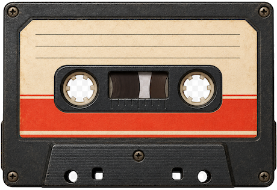 | 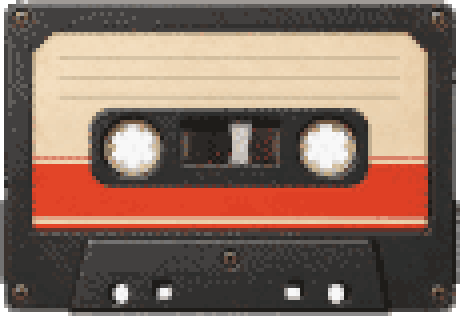 |
| 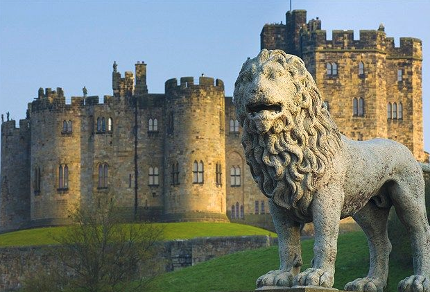 | 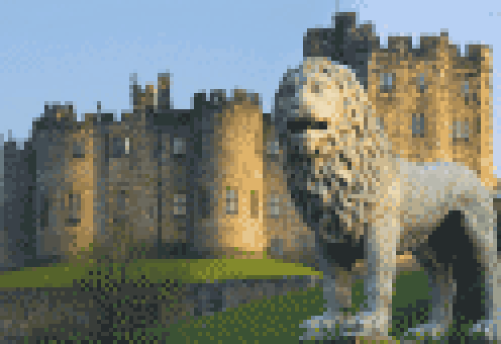 |
| 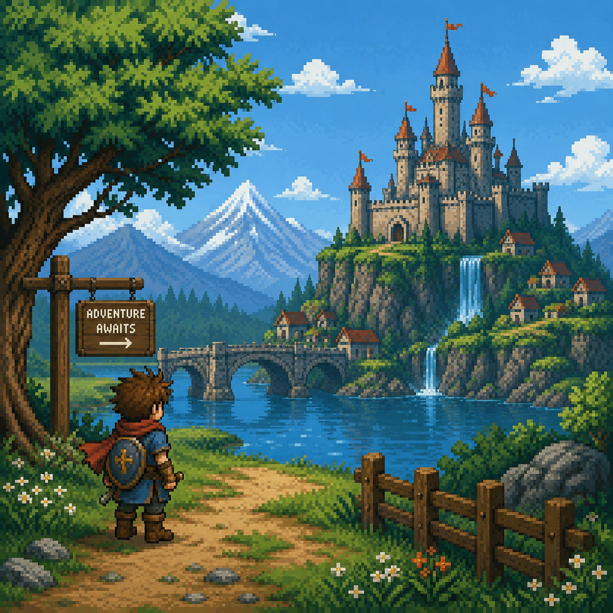 | 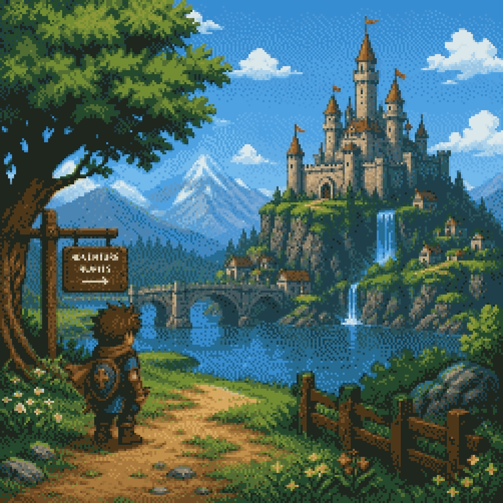 |

## Install

Quick install (Linux and macOS) — downloads a prebuilt binary:

```bash
curl -fsSL https://raw.githubusercontent.com/chris-roerig/pixelize/main/install.sh | sh
```

Install a specific version or to a custom directory:

```bash
PIXELIZE_VERSION=v0.2.0 curl -fsSL https://raw.githubusercontent.com/chris-roerig/pixelize/main/install.sh | sh
PIXELIZE_BINDIR="$HOME/.local/bin" curl -fsSL https://raw.githubusercontent.com/chris-roerig/pixelize/main/install.sh | sh
```

With Go:

```bash
go install github.com/chris-roerig/pixelize/cmd/pixelize@latest
```

Or build from source:

```bash
git clone https://github.com/chris-roerig/pixelize.git
cd pixelize
go build -o pixelize ./cmd/pixelize
```

## Usage

Flags can appear before, after, or between positional arguments:

```bash
pixelize input.png output.png --block 8 --scale 4
pixelize --block 16 --mode average input.jpg output.png
pixelize input.png --logical output.png
pixelize --version
pixelize --help
```

### Output Path Inference

The output argument is optional. With a single input, pixelize derives the
output name automatically:

```bash
pixelize photo.png                 # -> photo-pixelized.png
pixelize photo.png --preset gba    # -> photo-gba.png
```

The output format follows the output file's extension (`.png` or `.jpg`/`.jpeg`).

### Pipes (stdin / stdout)

Use `-` to read from standard input and/or write to standard output, so
pixelize composes in shell pipelines:

```bash
cat input.png | pixelize - - --preset gba > output.png
curl -s https://example.com/img.png | pixelize - --preset nes > out.png
```

### Batch Mode

Pass a directory to pixelize all supported images (`.png`, `.jpg`, `.jpeg`) inside it. Outputs are written to a `pixelized/` subfolder with the same filenames:

```bash
pixelize ./photos --block 8
# Creates ./photos/pixelized/ with processed versions
```

### Flags

| Flag | Default | Description |
|------|---------|-------------|
| `--block` | 8 | Pixel block size for sampling |
| `--scale` | match input | Nearest-neighbor output scale factor |
| `--colors` | 0 (unlimited) | Reduce palette to N colors |
| `--dither` | false | Apply Floyd-Steinberg dithering (requires --colors) |
| `--bw` | false | Reduce to black and white (dithered) |
| `--transparent` | false | Make white pixels transparent |
| `--mode` | average | Sampling mode |
| `--palette` | original | Color palette |
| `--sharpen` | false | Apply edge-enhancement sharpening |
| `--preset` | — | Apply a named preset, a path to a `.json` preset, or `all` |
| `--list-presets` | — | List available presets and exit |
| `--logical` | false | Export the logical pixel grid without scaling |
| `--version` | — | Print version and exit |

### Presets

Use `--preset` for quick styling. Explicit flags override preset values.

List everything available (built-in plus any you've added):

```bash
pixelize --list-presets
pixelize --list-presets-json   # machine-readable
```

| Preset | Description |
|--------|-------------|
| `retro` | Classic pixel art (block 8, 32 colors, dithered) |
| `gameboy` | Game Boy style (block 6, 4 colors, gameboy palette, dithered) |
| `pico8` | PICO-8 style (block 6, 16 colors, pico8 palette, dithered) |
| `nes` | NES style (block 6, 24 colors, nes palette, dithered) |
| `snes` | SNES style (block 5, 64 colors, dithered) |
| `genesis` | Sega Genesis style (block 6, 32 colors, dominant mode) |
| `gba` | Game Boy Advance style (block 4, 64 colors, dithered) |
| `n64` | Nintendo 64 style (block 5, 32 colors) |
| `ps1` | PlayStation 1 style (block 5, 48 colors, dithered, median) |
| `c64` | Commodore 64 style (block 8, 16 colors, dithered) |
| `cga` | CGA style (block 8, 4 colors, dithered) |
| `sprite` | Crisp sprites (block 4, dominant mode, sharpened) |
| `poster` | Poster style (block 12, 8 colors) |
| `chunky` | Big bold pixels (block 16, 16 colors) |
| `fine` | Subtle pixelation (block 3, 64 colors, median mode, dithered) |
| `mono` | Monochrome (block 6, 2 colors, gameboy palette, dithered) |

### Custom Presets

Presets are plain JSON files, so you can add your own without rebuilding. A
preset looks like this:

```json
{
  "name": "my-style",
  "description": "my custom look",
  "block": 10,
  "colors": 12,
  "dither": true,
  "sharpen": false,
  "mode": "average",
  "palette": "original"
}
```

pixelize loads presets from the following locations, in order of increasing
precedence (a later source overrides an earlier one with the same `name`):

1. **Built-in** presets shipped inside the binary.
2. **User** presets in `$XDG_CONFIG_HOME/pixelize/presets/` (defaults to
   `~/.config/pixelize/presets/`).
3. **Project** presets in `./.pixelize/presets/` relative to where you run the
   command.

You can also point `--preset` directly at a file:

```bash
pixelize input.png output.png --preset ./my-style.json
```

Notes:

- The `name` field is the preset's identifier (what you pass to `--preset`). If
  omitted, the file name (without `.json`) is used.
- Unknown fields are rejected, so typos like `"colour"` fail loudly with the
  offending file path.
- Each preset is validated on load; an invalid `mode`, `palette`, or `block`
  reports an error pointing at the file.
- To contribute a preset upstream, add a JSON file to
  `internal/cli/presets/` and open a pull request — no Go required.

## Examples

Generated with `pixelize --preset all`:

| retro | gameboy | pico8 | nes |
|-------|---------|-------|-----|
| 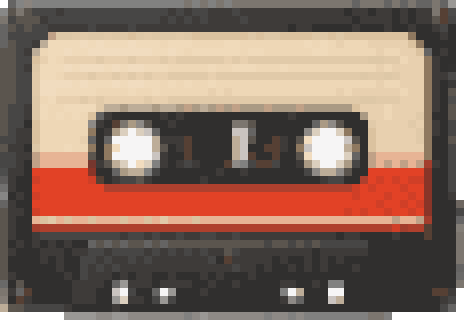 | 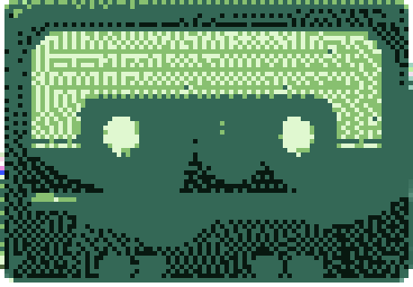 | 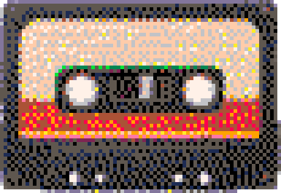 | 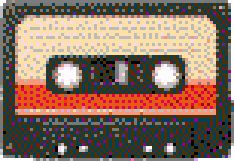 |

| snes | genesis | gba | ps1 |
|------|---------|-----|-----|
| 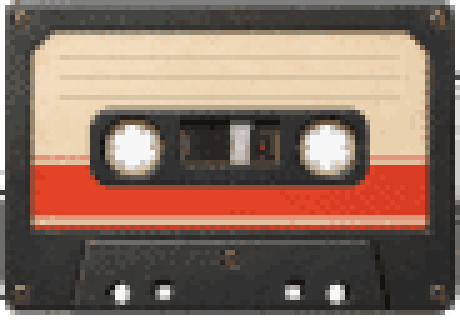 | 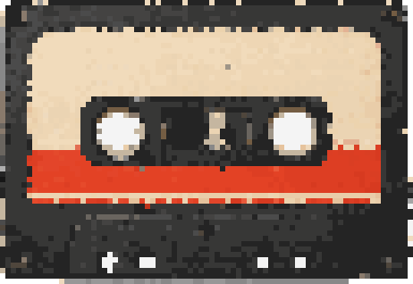 |  | 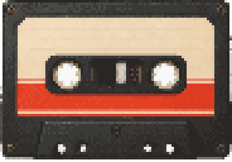 |

| n64 | c64 | cga | mono |
|-----|-----|-----|------|
| 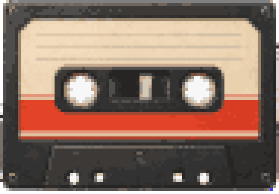 | 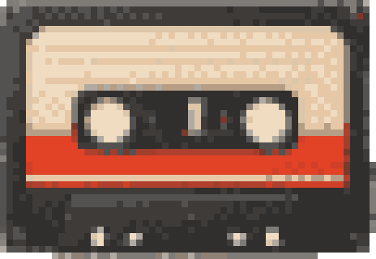 | 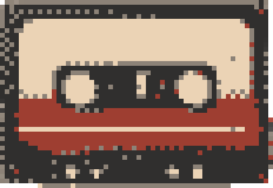 | 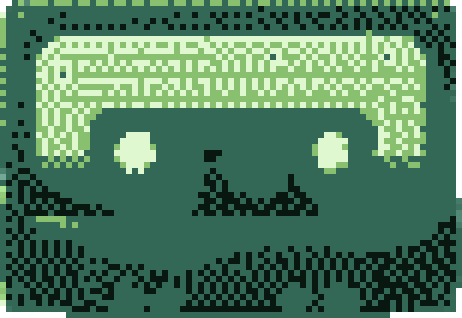 |

| sprite | poster | chunky | fine |
|--------|--------|--------|------|
| 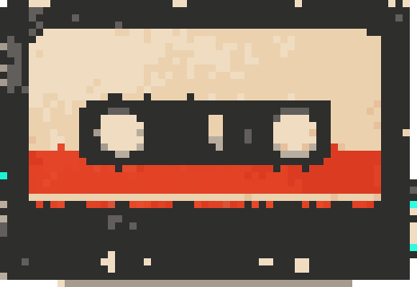 | 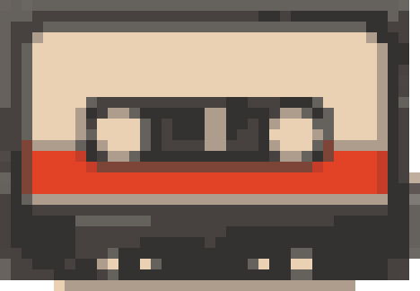 | 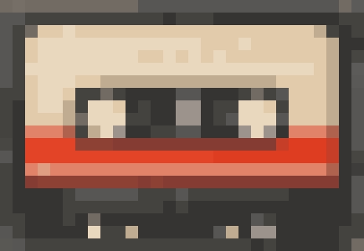 | 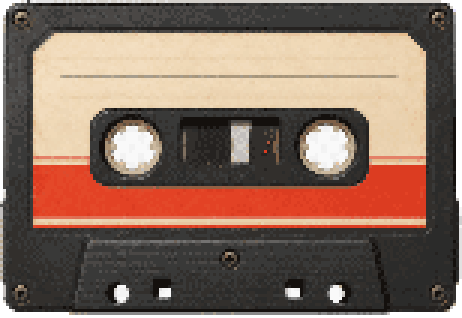 |

## How It Works

Given a 1024×1024 input with `--block 8`:

1. The image is divided into 8×8 blocks.
2. Each block is reduced to a single color (by default, the average of all pixels in that block).
3. This produces a **logical** image of 128×128 pixels.
4. Colors are optionally reduced (palette or `--colors`), then the grid is scaled.

Output depends on flags:

- `--logical` → outputs the 128×128 logical grid directly.
- `--scale 4` → scales the logical grid to 512×512 using nearest-neighbor interpolation.

Partial blocks (when dimensions aren't evenly divisible) are still sampled correctly.

### Color handling

pixelize does its color math carefully so output stays faithful to the source:

- **Linear-light averaging.** Block colors are averaged in linear light rather
  than gamma-encoded sRGB, which avoids the darkening bias that makes naive
  pixelizers look muddy.
- **Perceptual color matching.** Nearest-color decisions (both the built-in
  palettes and `--colors` reduction) use a perceptual distance (redmean) instead
  of raw RGB distance, so colors snap to the nearest color the eye expects.
- **Alpha-correct.** Transparency is handled consistently through sampling,
  dithering, and quantization.

### Order of operations

The pipeline applies, in order: block sampling → optional sharpen → optional
white-keying → exactly one color reduction → nearest-neighbor scaling.

Color reduction uses a single strategy, in precedence order: `--bw` > a named
palette (`pico8`/`gameboy`/`nes`) > `--colors`. When a named palette is set,
`--colors` is ignored rather than applied as a confusing second reduction.

## Supported Modes

| Mode | Description |
|------|-------------|
| `average` | Average color of all pixels in the block (in linear light) |
| `median` | Median color per channel (less affected by outliers) |
| `dominant` | Representative color of the most common region (preserves hard edges) |

## Supported Palettes

Palette matching uses a perceptual distance metric. List everything available
(built-in plus any you've added):

```bash
pixelize --list-palettes
```

| Palette | Description |
|---------|-------------|
| `original` | Use the computed colors as-is |
| `pico8` | PICO-8 16-color palette |
| `gameboy` | Game Boy 4-shade DMG green ramp |
| `nes` | NES system palette |

### Custom Palettes

Like presets, palettes are plain JSON files you can add without rebuilding. A
palette is a name plus a list of hex colors:

```json
{
  "name": "sunset",
  "description": "warm four-color sunset",
  "colors": ["#1a1a2e", "#e94560", "#f9ed69", "#f08a5d"]
}
```

Colors accept `#rgb`, `#rrggbb`, or `#rrggbbaa` (the `#` is optional). pixelize
loads palettes from the following locations, in order of increasing precedence
(a later source overrides an earlier one with the same `name`):

1. **Built-in** palettes shipped inside the binary.
2. **User** palettes in `$XDG_CONFIG_HOME/pixelize/palettes/` (defaults to
   `~/.config/pixelize/palettes/`).
3. **Project** palettes in `./.pixelize/palettes/`.

You can also point `--palette` directly at a file:

```bash
pixelize input.png output.png --palette ./sunset.json
```

To contribute a palette upstream, add a JSON file to
`internal/cli/palettes/` and open a pull request.
